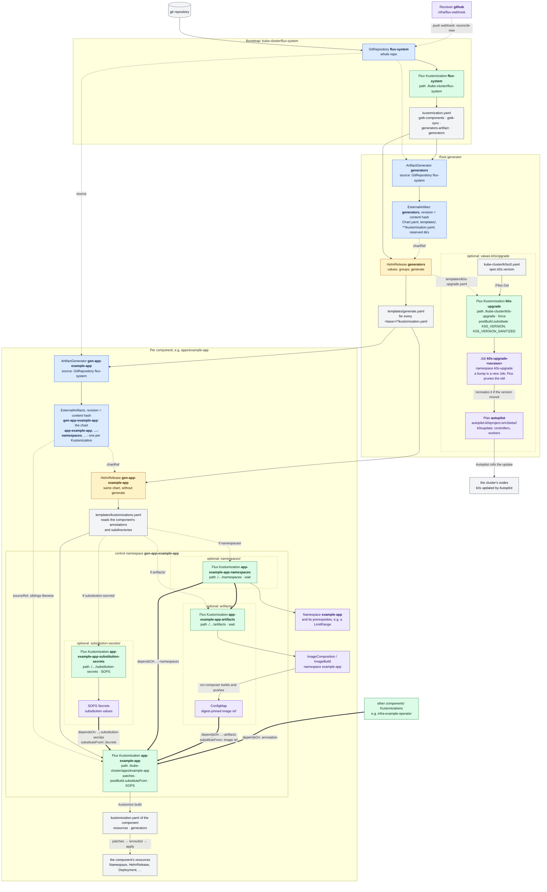

# k0s-flux

GitOps for a [k0s](https://k0sproject.io) Kubernetes cluster, reconciled by
[Flux](https://fluxcd.io).

The core idea: **one directory is one component, and every component gets its own Flux
`Kustomization`.** Nobody maintains a list of Kustomizations. A Helm chart at the repo root,
`flux-component-generator`, discovers every `kube-cluster/<group>/<component>/kustomization.yaml`
and emits the Flux objects for it. Adding an app means adding a directory. Each component is its
own failure domain: a broken app cannot block the others.

## How it works



Blue nodes are sources (source-controller), green ones are Flux Kustomizations
(kustomize-controller), yellow ones are HelmReleases (helm-controller), purple ones are objects
the Kustomizations create, and grey ones are files and the resources that come out. A **dashed
box** marks what only exists when the component, or for k0s-upgrade the root release's
values, opts in. Solid arrows create or feed. **Thick arrows** are `dependsOn`, so the target waits for
that Kustomization to be Ready, and where they come from `artifacts/` or
`substitution-secrets/`, the component also substitutes that box's values. Dashed arrows
reference or trigger.

In words:

1. The Flux bootstrap applies `kube-cluster/flux-system/`. Besides Flux itself, that holds the
   generator's source and its HelmRelease.
2. The **root release** renders the chart once. For each discovered component it emits an
   ArtifactGenerator and a HelmRelease, `gen-<group>-<component>`. With `values.k0sUpgrade` it also
   emits `k0s-upgrade`, whose Job, named after the k0s version in `k0sctl.yaml`, recreates the
   Autopilot Plan when that version moves.
3. Each **per-component release** renders the same chart against an artifact filtered down to
   that component, and emits its Flux Kustomization, plus the optional `-namespaces`,
   `-artifacts` and `-substitution-secrets` ones. They live in the component's own **control
   namespace** `gen-<group>-<component>`, which the release also creates; see
   [Control namespaces and risky changes](#control-namespaces-and-risky-changes).
4. The **ArtifactGenerator** packs the component's chart and each Kustomization's files out of
   the `flux-system` checkout into ExternalArtifacts. Their revision is a hash of their content,
   so a commit reconciles only what it changed; see [ExternalArtifacts](#externalartifacts).

The split into one release per component is not cosmetic. Helm stores the whole chart in a
1 MiB release Secret, and here the chart is the repository; see
[docs/generator-chart-size.md](docs/generator-chart-size.md). A GitHub push webhook reconciles
`flux-system` and `generators` immediately, so a push applies in seconds.

## Repository layout

```
Chart.yaml, templates/         flux-component-generator, the root Helm chart
kube-cluster/                  one cluster; the directory name is the cluster's
  k0sctl.yaml                  the cluster itself (k0s, CNI, control plane), applied with k0sctl
  flux-system/                 Flux bootstrap + the generator's source and HelmRelease
  infra/<component>/           what the cluster and other components need to function: storage,
                               ingress, databases, shared operators
  apps/<component>/            applications, and operators that serve only one app
  rbac/<component>/            cluster-wide RBAC
  k0s-upgrade/                 the in-cluster k0s upgrade wrapper
kube-test-cluster/             a second cluster: same shape, its own k0sctl.yaml and flux-system/
shared/                        plain kustomize bases more than one cluster deploys
scripts/                       validation, rendering, secret handling, the public-template build
tests/                         generator fixtures and golden output
docs/                          design notes and operations
```

k0sctl creates the cluster and is run by hand. Everything inside the cluster is Flux.

Nothing in the generator is tied to the cluster directory's name. Its groups are plain `base`
paths (`values.groups` of the root HelmRelease in `<cluster>/flux-system/`), and each cluster renders
only its own, in its own root release: see [Multiple clusters](#multiple-clusters).

## Adding a component

1. Create `kube-cluster/apps/<name>/` (or `infra/`, `rbac/`) with your manifests.
2. Add a `kustomization.yaml` listing them. Generator settings go in its annotations:

   ```yaml
   apiVersion: kustomize.config.k8s.io/v1beta1
   kind: Kustomization
   metadata:
     annotations:
       flux-component-generator/dependsOn: infra-example-operator,infra-example-storage
   resources:
   - resources.yaml
   ```

3. Commit and push. The generator emits `app-<name>` within seconds.
4. Check that it actually applied: see
   [Checking a deploy landed](docs/operations.md#checking-a-deploy-landed).

## Generator reference

### Annotations

All on the component's own `kustomization.yaml`. Kustomize ignores `metadata` there, so these
never reach the cluster.

| annotation | default | effect |
| --- | --- | --- |
| `flux-component-generator/dependsOn` | none | comma-separated Flux Kustomization names this component waits for |
| `flux-component-generator/appInstance` | directory name | the `app.kubernetes.io/instance` label put on everything, for when a chart labels its workloads differently |
| `flux-component-generator/crdPolicy` | `CreateReplace` | `spec.upgrade.crds` for the component's HelmReleases: `Skip`, `Create` or `CreateReplace`; see [Chart CRDs are upgraded](#chart-crds-are-upgraded) |
| `flux-component-generator/suspend` | `false` | `"true"` suspends the component's Kustomization; its `gen-` release stays live |
| `flux-component-generator/bases` | none | comma-separated `shared/` directories the component's kustomization reaches through `../`; each is copied into its artifact. See [Multiple clusters](#multiple-clusters) |

### Reserved subdirectories

Each is opt-in by existing. None holds a `kustomization.yaml`: kustomize-controller
synthesizes one.

- **`namespaces/`** holds the component's Namespace and what must exist in it first, such as a
  LimitRange. It gets its own Kustomization, and both the component and `artifacts/` wait for it.
  Flux never prunes what it holds: a pruned Namespace takes every PVC inside. Removing a component
  therefore leaves its Namespace; see
  [docs/operations.md](docs/operations.md#removing-a-component). Moving an existing Namespace in
  from the component is still a prune risk, since the component Kustomization prunes what leaves
  its build: follow [Control namespaces and risky changes](#control-namespaces-and-risky-changes).

- **`substitution-secrets/`** holds SOPS Secrets in the component's control namespace. They get
  their own
  Kustomization, the component waits for it, and each one becomes a
  `postBuild.substituteFrom` entry, so the component's config can stay plaintext with
  `${VAR}` placeholders.
- **`artifacts/`** holds the component's `ImageComposition` and `ImageBuild` objects. Each one
  exports its digest-pinned ref into a ConfigMap in that same namespace, which the component
  substitutes as `${VAR}`.
  They go in the component's namespace, declared in `namespaces/`.
  See [`infra/oci-composer`](kube-cluster/infra/oci-composer/README.md).

### Substitution caveats

`substitution-secrets/` or `artifacts/` turns on envsubst for the **whole component build**, not just the file you
meant. Flux fails the reconcile on any `${VAR}` it cannot resolve, and applies `$$` as `$`.
Before adding one, run:

```sh
kustomize build kube-cluster/apps/<app> | grep -E '\$\{|\$\$'
```

Every hit has to become a substitution source, be escaped as `$${VAR}`, or sit in an object
annotated `kustomize.toolkit.fluxcd.io/substitute: disabled`. Shell scripts and regex
replacements are the usual casualties. A bare `$var` is left alone.

### Substituted config files: `as-secret`

A `secretGenerator` base64-encodes into `data:`, where envsubst cannot see `${VAR}`. Use a
`configMapGenerator` marked `flux-component-generator/as-secret` instead. The generator patches
it into a Secret, with the content still plaintext, so the config stays a real file:

```yaml
configMapGenerator:
- name: example-app-config
  namespace: example-app
  files:
  - example-app.conf
  options:
    disableNameSuffixHash: true
    annotations:
      flux-component-generator/as-secret: "true"
```

`disableNameSuffixHash` is required. The patch matches on the annotation, but the workload
refers to a Secret, which is a reference kustomize does not rewrite to the hashed name.
`scripts/check-substitution.py` fails the build on a missing annotation (the credential would
be applied as a ConfigMap) and on a missing `disableNameSuffixHash`.

Better still, use the app's own mechanism where it has one, such as reading the credential from
an env var or a mounted Secret, so the config holds no credential at all.

## Conventions

### Namespacing

Every namespaced object declares its namespace explicitly:

- hand-written resources: `metadata.namespace`;
- generated objects: a `namespace:` field **on the generator entry**. Without one, they fail to
  apply with `namespace not specified`.

**Never** put a top-level `namespace:` in a `kustomization.yaml`. That transformer
force-overrides every object, including ones deliberately pinned elsewhere, such as a database
role that lives in the database operator's namespace, and silently breaks multi-namespace apps.

### Getting files into a workload

Never fetch plugins, extensions or config bundles at pod start. That makes startup depend on
the network, pins by ref instead of content, and usually turns a cache into state on a PVC.

1. **The content is already an image:** mount it as an image volume (always read-only). Use
   `subPath` for layout:

   ```yaml
   volumes:
     - name: plugin
       image:
         reference: ghcr.io/example/example-plugin:1.0.0
   volumeMounts:
     - name: plugin
       mountPath: /app/plugins
       subPath: plugins
   ```

2. **The content is not an image** (git repos and monorepo subpaths, jars by URL,
   ConfigMaps): compose one with [`infra/oci-composer`](kube-cluster/infra/oci-composer/README.md)
   from the component's `artifacts/`.

The line between the two is whether the inputs are already images, not how complex the result
is.

Renovate's `kubernetes` manager only sees `image: <string>`, not an image volume's
`image: {reference: …}`. `renovate.json` has a custom manager for image volumes, anchored on
an explicit `# renovate:` comment, so moving a reference into an image volume needs that
comment or the auto-bump stops silently.

### Reconciliation intervals

The GitHub webhook drives reconciliation, so `interval` is only the fallback and drift
correction.

| kind | interval | why |
| --- | --- | --- |
| sources: `GitRepository`, `HelmRepository`, `OCIRepository`, a HelmRelease's `chart.spec` | `1h` | git is pushed by the webhook; upstream charts and images are pinned exactly, so polling re-fetches the same artifact. Shorten only for a floating tag. |
| reconcilers: `Kustomization`, `HelmRelease` | `10m` | re-apply desired state and undo manual drift |

The generated Kustomizations already default to `10m`.

## Secrets

Secrets are SOPS-encrypted with age, one key per cluster: `.sops.yaml` has a rule per cluster
directory, and only that cluster holds the private key (`flux-system/sops-age`). The generator
adds decryption to every component Kustomization.
Flux reads it from the Kustomization's own namespace, so every control namespace needs a copy:
Reflector makes one, after a one-time annotation described in
[infra/reflector](shared/infra/reflector/README.md#sops-age-in-control-namespaces).

### Handing over a secret

Copy the secret, then run:

```sh
python3 scripts/secret-from-clipboard.py kube-cluster/apps/foo/secret-bar.yaml bar foo TOKEN
```

A dialog shows the target and a masked field that follows the clipboard until you type or
paste into it, so the secret can also be copied after it opens. For a binary value, pick a
file with the folder button or drop it on the dialog (natively on Windows, with `tkinterdnd2`
on Linux). It goes in as base64 under `data:` (text goes under `stringData:`), at most 1 MiB.
OK writes a SOPS-encrypted `Secret` for you to commit. The value, and a text value's length,
never reach a terminal, a command line or a plaintext file.

Since only the cluster can decrypt, it is one Secret per file: adding a key to an existing
encrypted file needs the cluster's key. Requires `sops` and tkinter (`python3-tk`); the tests in
`tests/secret-from-clipboard.py` need `age-keygen` and a display.

## Validation and tests

`scripts/validate.sh` is the single entry point, for people and CI. It runs:

- `yamllint`;
- the `kustomize build` + strict `kubeconform` sweep over every component of every cluster
  (any `*/flux-system/kustomization.yaml`) and the rendered generator output;
- the release-size, substitution, source-pin and SOPS checks, and the offline test of the
  migration gate;
- `scripts/check-clusters.py`: each cluster reads only its own directory, and `shared/` holds
  only plain bases;
- `scripts/check-artifacts.py`: every component builds from exactly what its ExternalArtifact
  holds, which catches a `../` out of the component;
- the per-component tests (see [kube-cluster/README.md](kube-cluster/README.md)).

It also renders the generator against `tests/fixtures/` and diffs the result against
`tests/golden/fixtures.yaml`. The fixtures cover what the live tree does not: a component with no
annotations, every annotation set, a `substitution-secrets/` dir with a wrong-namespace Secret,
artifacts with and without a resolvable `sourceRef`, `namespaces/` with artifacts in the
component's own namespace, components with prune off, and one depending on another
component's internal Kustomization, and one with `bases`. `tests/golden/fixtures-generate.yaml`
pins the same fixtures through the root release's `generate` path, and
`tests/generator-guards.sh` the renders it must refuse: two components generating one name,
and a base outside `shared/`. For an intentional behaviour change, run
`bash scripts/update-golden.sh` and review that diff: it *is* the change.

## Multiple clusters

Each cluster is a top-level directory with a `flux-system/kustomization.yaml`; the scripts and
CI find them by that, and its generator root by content (the HelmRelease with `values.groups`,
the ArtifactGenerator copying `Chart.yaml`), whatever the file names. `kube-cluster/` is prod,
`kube-test-cluster/` is a second cluster, scaffolded but not yet bootstrapped
([its README](kube-test-cluster/README.md) lists the placeholders).

### What each cluster has of its own

| piece | why it cannot be shared |
| --- | --- |
| `flux-system/gotk-sync.yaml` | syncs `./<cluster>/flux-system`; it is how a cluster knows which directory is its own |
| `flux-system/generators-artifact.yaml` | the root chart's copy rules name `<cluster>/` paths only, never `*/`, or every root release would carry every cluster's files |
| `flux-system/generators.yaml` | groups `<cluster>/{apps,infra,rbac}`, with the same prefixes everywhere, and `k0sUpgrade` |
| `flux-system/gotk-components.yaml`, `kustomization.yaml` | Flux and its controller tuning, sized per cluster |
| `k0sctl.yaml`, `k0s-upgrade/` | the cluster itself |
| an age key and a `.sops.yaml` rule | a cluster must not be able to decrypt another's secrets |

`scripts/check-clusters.py` enforces the first three and the key, and `gen-flux.sh` takes
`CLUSTER=<dir>`.

### Shared bases

`shared/infra/<name>/`, `shared/components/<name>/` and `shared/k0s-upgrade/` are plain
kustomize bases: no generator annotations, no reserved directories and no SOPS files, since a
base reaches every cluster and each cluster decrypts only its own secrets. A cluster deploys one
from an overlay, its own component directory:

```yaml
# kube-cluster/infra/reloader/kustomization.yaml
metadata:
  annotations:
    flux-component-generator/bases: shared/infra/reloader
resources:
- ../../../shared/infra/reloader
patches:
- path: version.yaml
```

The component builds inside its ExternalArtifact, which normally holds only its own directory.
`flux-component-generator/bases` adds each listed `shared/` directory to it at its repo path, so
the `../` resolves there too. A missing entry builds locally and fails only in the cluster;
`scripts/check-artifacts.py` catches it. `k0s-upgrade/` needs no annotation: its Kustomization
reads the whole repo.

**An edit to a base reaches every cluster in the same push.** So versions live in the overlays,
never in a base: a chart version as a patch shaped like a whole HelmRelease (which Renovate's
flux manager reads; an inline patch it does not), an image tag as kustomize `images:`. The
overlay is also where a cluster's values, namespaces and secrets go.

### Promoting a version

Each cluster's overlay holds its own pin, so Renovate opens one PR per cluster. A per-path
`packageRule` in `renovate.json` automerges minor and patch updates under `kube-test-cluster/`,
so a version runs there before the reviewed PR for `kube-cluster/` is merged. The rules that
hold a package back (k0s, MariaDB, ...) come later in the file and still apply.

### Bootstrapping a cluster

Never `flux bootstrap`: without `--components-extra=source-watcher` it removes source-watcher,
and every component stops deploying. Instead, for `<cluster>`:

1. Fill the placeholders, then `k0sctl apply --config <cluster>/k0sctl.yaml` and fetch the
   kubeconfig. Every command below talks to the new cluster.
2. `kubectl apply --server-side -f <cluster>/flux-system/gotk-components.yaml`, so the CRDs
   exist before anything uses them.
3. The git credential `gotk-sync.yaml` names: `flux create secret git flux-system
   --url=https://github.com/example/k0s-flux.git --username=<user> --password=<token>`, or a deploy
   key.
4. The cluster's age key, from where you stored it, as `flux-system/sops-age` with key
   `age.agekey`, and the Reflector annotations from
   [infra/reflector](shared/infra/reflector/README.md#sops-age-in-control-namespaces).
5. `kubectl apply -k <cluster>/flux-system`. From here Flux reconciles itself.
6. Once `gen-infra-reflector` exists, copy `sops-age` into it by hand, once
   ([why](shared/infra/reflector/README.md#sops-age-in-control-namespaces)).
7. `flux get kustomizations -A` until every one is Ready.

A new cluster also needs its own `.sops.yaml` rule and key (`age-keygen`, the private half never
in git), and its paths in `renovate.json`'s file patterns.

## Details

### Chart CRDs are upgraded

Helm never touches a chart's `crds/` directory on upgrade, and helm-controller's default for
`spec.upgrade.crds` is `Skip`. Left alone, a chart's CRDs freeze at the version first installed,
with no error anywhere. New fields then do not exist, and the API server prunes them from every
resource that sets one.

There is no controller-wide setting, so the generator patches `crds: CreateReplace` into every
`HelmRelease` of every component. It is a merge patch, so other `spec.upgrade` fields survive.
This only matters for charts that ship a `crds/` directory; charts that template their CRDs
already upgrade them.

`CreateReplace` replaces. For additive schema changes, which a CRD bump almost always is, that
is safe. If a chart drops a CRD version that still has stored objects, the API server rejects
it, so the failure is loud. Override per component with
`flux-component-generator/crdPolicy`.

### Moving a component between groups

The Flux Kustomization is named after the directory, so moving `apps/example-db/` to
`infra/example-db/` deletes `app-example-db` and creates `infra-example-db`. **Deleting a
Kustomization prunes everything it manages.** For a stateless component that is harmless. For a
stateful one it deletes the PVCs, and the workload starts empty.

Adopt in place instead:

1. Add `kustomize.toolkit.fluxcd.io/prune: disabled` to every resource of the component (for
   example via `commonAnnotations:`), push, and let it reconcile.
2. `git mv` the directory to the new group and push. The old Kustomization goes, but the
   objects are kept, and the new one adopts them.
3. Remove the annotation again and push.

Check that the workload never restarted.

### Control namespaces and risky changes

The generator puts every component's Kustomizations in Namespace `gen-<group>-<component>`,
created by its `gen-` release. Flux reads `substituteFrom` and `sops-age` only from the
Kustomization's own namespace, so the component's `substitution-secrets/` objects and
`writeRefTo` ConfigMaps go there too; the template and `scripts/check-substitution.py` refuse
them in `flux-system`. Other components' `dependsOn` name that namespace.

A change that can make a Kustomization build fewer objects, and so delete what it should keep,
such as moving a Namespace into `namespaces/` or a change to what an artifact copies, runs with
prune off. `generate.pruneDisabled` in `kube-cluster/flux-system/generators.yaml` takes
generated Kustomization names, or `"*"`, and sets `prune: false` on all of a component's
Kustomizations. One PR per step, and `scripts/check-migration.py` green before the next:

1. `snapshot <name> --out <file outside the repo>`. PR: add it to `pruneDisabled`. After
   deploy: `verify-prune-disabled <name>`.
2. PR: the change. After deploy: `verify-moved <name> --snapshot <file>`: Kustomizations only
   in `gen-<name>` with `prune: false`, each on its own ExternalArtifact, every inventory
   object with the same UID and owned by a Kustomization of the component, PVCs, PVs and
   namespaces unchanged, no pod restarted, `sops-age` and the substitution sources present.
3. PR: remove it from `pruneDisabled`. After deploy: `verify-done <name> --snapshot <file>`.

Any deviation: stop, and revert the last PR while prune is still off. Start with one stateless
component.

A change to the root release itself (its chart source or name, the release name, or a
re-bootstrap) risks an uninstall of the root, which would delete every `gen-` release and,
through prune, everything they applied. Around it, set `generate.keepGenerated: true`: the
root's ArtifactGenerators and `gen-` HelmReleases get `helm.sh/resource-policy: keep`, so Helm
leaves them in place. Not permanently: it also stops Helm from deleting a removed component's.

1. PR: `pruneDisabled: ["*"]` and `keepGenerated: true`. After deploy: every `gen-` HelmRelease
   and ArtifactGenerator carries the annotation, and `verify-prune-disabled` passes.
2. PR: the root change. After deploy: the root release upgraded in place (same UID, history
   +1), and `verify-moved` passes.
3. PR: remove both values. After deploy: `verify-done`.

### ExternalArtifacts

For each component, the root release emits an ArtifactGenerator `gen-<group>-<component>`
(source-watcher) over the `flux-system` GitRepository, with one ExternalArtifact per consumer,
all in `flux-system`:

- `gen-<group>-<component>`: `Chart.yaml`, `templates/`, the component's `kustomization.yaml`
  and its reserved directories' `*.yaml`, under `generators/`, since Helm refuses a chart at the
  archive root. Its `gen-` HelmRelease reads it through `chartRef`.
- `<name>`, plus `<name>-namespaces`, `-artifacts` and `-substitution-secrets` where those
  directories exist: the component directory without them, and each of them, at their repo
  paths. Each Kustomization's `sourceRef` names its own; `spec.path` is the repo path.

Siblings do not wait for the same commit, so the Kustomizations get `retryInterval: 1m`.
Substitution Secrets carry `reconcile.fluxcd.io/watch: Enabled`, so a Secret-only change still
reaches its consumer at once.

An artifact missing a file builds fewer objects, and prune deletes the rest: change what
`templates/generate.yaml` copies as in
[Control namespaces and risky changes](#control-namespaces-and-risky-changes).

source-watcher is an extra Flux component: a `flux bootstrap` without
`--components-extra=source-watcher` removes it and its CRD, and every component stops
deploying. Use `scripts/gen-flux.sh`.

## Further documentation

- [kube-cluster/README.md](kube-cluster/README.md): per-component tests.
- [kube-test-cluster/README.md](kube-test-cluster/README.md): the second cluster and its
  placeholders.
- [docs/operations.md](docs/operations.md): checking a deploy landed, node maintenance.
- [docs/generator-chart-size.md](docs/generator-chart-size.md): why there is one release per
  component.
- [docs/adr/](docs/adr/README.md): the architecture decisions and their history. A change
  that decides something about the cluster or the repo's structure adds one.
- Each component's own `README.md`, next to its manifests.
