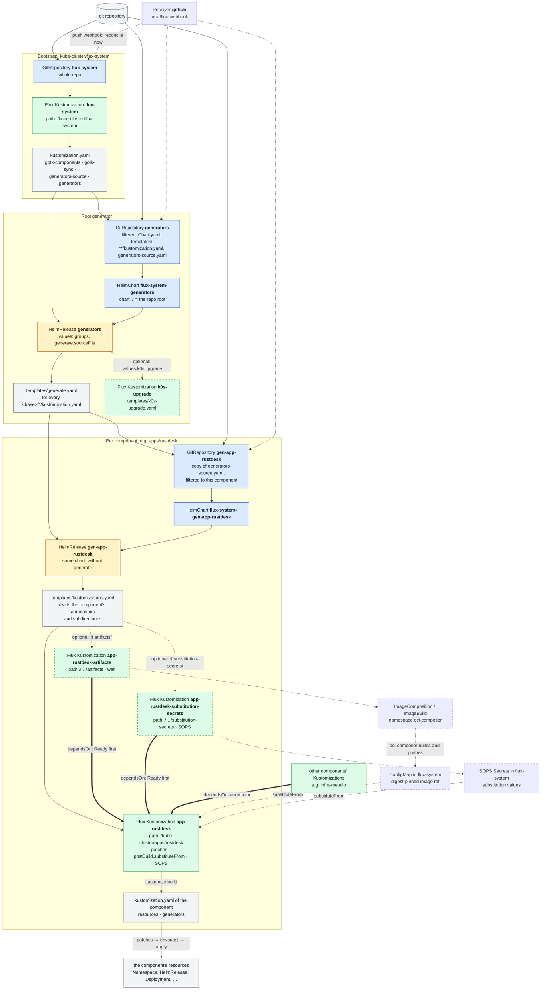

# k0s-flux

GitOps for a [k0s](https://k0sproject.io) Kubernetes cluster, reconciled by
[Flux](https://fluxcd.io).

The core idea: **one directory is one component, and every component gets its own Flux
`Kustomization`.** Nobody maintains a list of Kustomizations. A Helm chart at the repo root,
`flux-component-generator`, discovers every `kube-cluster/<group>/<component>/kustomization.yaml`
and emits the Flux objects for it. Adding an app means adding a directory. Each component is its
own failure domain: a broken app cannot block the others.

## How it works



Blue nodes are sources (source-controller), green ones are Flux Kustomizations
(kustomize-controller), yellow ones are HelmReleases (helm-controller), and grey ones are files
and the resources that come out. A **dashed border** marks objects that only exist when the
component opts in. Solid arrows create or feed. **Thick arrows** are `dependsOn`, so the
component waits for that Kustomization to be Ready. Dashed arrows reference or trigger.

In words:

1. The Flux bootstrap applies `kube-cluster/flux-system/`. Besides Flux itself, that holds the
   generator's source and its HelmRelease.
2. The **root release** renders the chart once. For each discovered component it emits a
   GitRepository and a HelmRelease, `gen-<group>-<component>`.
3. Each **per-component release** renders the same chart against a source filtered down to
   that component, and emits its Flux Kustomization, plus the optional `-artifacts` and
   `-substitution-secrets` ones.

The split into one release per component is not cosmetic. Helm stores the whole chart in a
1 MiB release Secret, and here the chart is the repository; see
[docs/generator-chart-size.md](docs/generator-chart-size.md). The per-component GitRepositories
copy `generate.sourceFile` (`kube-cluster/flux-system/generators-source.yaml`), so the URL,
credentials and any submodules or includes are set once. A GitHub push webhook reconciles all
of these sources immediately, so a push applies in seconds.

## Repository layout

```
Chart.yaml, templates/         flux-component-generator, the root Helm chart
kube-cluster/
  k0sctl.yaml                  the cluster itself (k0s, CNI, control plane), applied with k0sctl
  flux-system/                 Flux bootstrap + the generator's source and HelmRelease
  infra/<component>/           platform: storage, ingress, databases, operators
  apps/<component>/            applications
  rbac/<component>/            cluster-wide RBAC
  k0s-upgrade/                 the in-cluster k0s upgrade wrapper
scripts/                       validation, rendering, secret handling, the public-template build
tests/                         generator fixtures and golden output
docs/                          design notes and operations
```

k0sctl creates the cluster and is run by hand. Everything inside the cluster is Flux.

## Adding a component

1. Create `kube-cluster/apps/<name>/` (or `infra/`, `rbac/`) with your manifests.
2. Add a `kustomization.yaml` listing them. Generator settings go in its annotations:

   ```yaml
   apiVersion: kustomize.config.k8s.io/v1beta1
   kind: Kustomization
   metadata:
     annotations:
       flux-component-generator/dependsOn: infra-metallb,infra-ceph-csi-rbd
   resources:
   - resources.yaml
   ```

3. Commit and push. The generator emits `app-<name>` within seconds.
4. Check that it actually applied: see
   [Checking a deploy landed](kube-cluster/README.md#checking-a-deploy-landed).

## Generator reference

### Annotations

All on the component's own `kustomization.yaml`. Kustomize ignores `metadata` there, so these
never reach the cluster.

| annotation | default | effect |
| --- | --- | --- |
| `flux-component-generator/dependsOn` | none | comma-separated Flux Kustomization names this component waits for |
| `flux-component-generator/appInstance` | directory name | the `app.kubernetes.io/instance` label put on everything, for when a chart labels its workloads differently |
| `flux-component-generator/crdPolicy` | `CreateReplace` | `spec.upgrade.crds` for the component's HelmReleases: `Skip`, `Create` or `CreateReplace`; see [Chart CRDs are upgraded](#chart-crds-are-upgraded) |
| `flux-component-generator/suspend` | `false` | `"true"` suspends the component's Kustomization; its `gen-` release stays live |

### Reserved subdirectories

Both are opt-in by existing. Neither holds a `kustomization.yaml`: kustomize-controller
synthesizes one.

- **`substitution-secrets/`** holds SOPS Secrets in `flux-system`. They get their own
  Kustomization, the component waits for it, and each one becomes a
  `postBuild.substituteFrom` entry, so the component's config can stay plaintext with
  `${VAR}` placeholders.
- **`artifacts/`** holds the component's `ImageComposition` and `ImageBuild` objects. Each one
  exports its digest-pinned ref into a ConfigMap, which the component substitutes as `${VAR}`.
  See [`infra/oci-composer`](kube-cluster/infra/oci-composer/README.md).

### Substitution caveats

Either subdirectory turns on envsubst for the **whole component build**, not just the file you
meant. Flux fails the reconcile on any `${VAR}` it cannot resolve, and applies `$$` as `$`.
Before adding one, run:

```sh
kustomize build kube-cluster/apps/<app> | grep -E '\$\{|\$\$'
```

Every hit has to become a substitution source, be escaped as `$${VAR}`, or sit in an object
annotated `kustomize.toolkit.fluxcd.io/substitute: disabled`. Shell scripts and regex
replacements are the usual casualties. A bare `$var` is left alone.

### Substituted config files: `as-secret`

A `secretGenerator` base64-encodes into `data:`, where envsubst cannot see `${VAR}`. Use a
`configMapGenerator` marked `flux-component-generator/as-secret` instead. The generator patches
it into a Secret, with the content still plaintext, so the config stays a real file:

```yaml
configMapGenerator:
- name: mosquitto-config
  namespace: mosquitto
  files:
  - mosquitto.conf
  options:
    disableNameSuffixHash: true
    annotations:
      flux-component-generator/as-secret: "true"
```

`disableNameSuffixHash` is required. The patch matches on the annotation, but the workload
refers to a Secret, which is a reference kustomize does not rewrite to the hashed name.
`scripts/check-substitution.py` fails the build on a missing annotation (the credential would
be applied as a ConfigMap) and on a missing `disableNameSuffixHash`.

Better still, use the app's own mechanism where it has one, so the config holds no credential
at all. For example, `apps/arr/autopulse` reads `AUTOPULSE__*` env vars.

## Conventions

### Namespacing

Every namespaced object declares its namespace explicitly:

- hand-written resources: `metadata.namespace`;
- generated objects: a `namespace:` field **on the generator entry**. Without one, they fail to
  apply with `namespace not specified`.

**Never** put a top-level `namespace:` in a `kustomization.yaml`. That transformer
force-overrides every object, including ones deliberately pinned elsewhere, such as a CNPG
`Database` living in `postgres`, and silently breaks multi-namespace apps. Examples:
`authelia`, `zensical` (generators with `namespace:`); `matrix`, `stalwart` (multi-namespace).

### Getting files into a workload

Never fetch plugins, extensions or config bundles at pod start. That makes startup depend on
the network, pins by ref instead of content, and usually turns a cache into state on a PVC.

1. **The content is already an image:** mount it as an image volume (always read-only). Use
   `subPath` for layout:

   ```yaml
   volumes:
     - name: app-view-plugin
       image:
         reference: ghcr.io/lhns/headlamp-app-view:0.3.0
   volumeMounts:
     - name: app-view-plugin
       mountPath: /headlamp/user-plugins
       subPath: plugins
   ```

   Example: `apps/headlamp`.

2. **The content is not an image** (git repos and monorepo subpaths, jars by URL,
   ConfigMaps): compose one with [`infra/oci-composer`](kube-cluster/infra/oci-composer/README.md)
   from the component's `artifacts/`. Example: `apps/freshrss`.

The line between the two is whether the inputs are already images, not how complex the result
is.

Renovate's `kubernetes` manager only sees `image: <string>`, not an image volume's
`image: {reference: …}`. `renovate.json` has a custom manager for image volumes, anchored on
an explicit `# renovate:` comment, so moving a reference into an image volume needs that
comment or the auto-bump stops silently.

### Reconciliation intervals

The GitHub webhook drives reconciliation, so `interval` is only the fallback and drift
correction.

| kind | interval | why |
| --- | --- | --- |
| sources: `GitRepository`, `HelmRepository`, `OCIRepository`, a HelmRelease's `chart.spec` | `1h` | git is pushed by the webhook; upstream charts and images are pinned exactly, so polling re-fetches the same artifact. Shorten only for a floating tag. |
| reconcilers: `Kustomization`, `HelmRelease` | `10m` | re-apply desired state and undo manual drift |

The generated Kustomizations already default to `10m`.

## Secrets

Secrets are SOPS-encrypted with age. Only the cluster holds the private key
(`flux-system/sops-age`), and the generator adds decryption to every component Kustomization.

### Handing over a secret

Copy the secret, then run:

```sh
python3 scripts/secret-from-clipboard.py kube-cluster/apps/foo/secret-bar.yaml bar foo TOKEN
```

A dialog shows the target and a masked field that follows the clipboard until you type or
paste into it, so the secret can also be copied after it opens. For a binary value, pick a
file with the folder button or drop it on the dialog (natively on Windows, with `tkinterdnd2`
on Linux). It goes in as base64 under `data:` (text goes under `stringData:`), at most 1 MiB.
OK writes a SOPS-encrypted `Secret` for you to commit. The value, and a text value's length,
never reach a terminal, a command line or a plaintext file.

Since only the cluster can decrypt, it is one Secret per file: adding a key to an existing
encrypted file needs the cluster's key. Requires `sops` and tkinter (`python3-tk`); the tests in
`tests/secret-from-clipboard.py` need `age-keygen` and a display.

## Validation and tests

`scripts/validate.sh` is the single entry point, for people and CI. It runs:

- `yamllint`;
- the `kustomize build` + strict `kubeconform` sweep over every component and the rendered
  generator output;
- the release-size, substitution, source-pin and SOPS checks;
- the per-component tests (see [kube-cluster/README.md](kube-cluster/README.md)).

It also renders the generator against `tests/fixtures/` and diffs the result against
`tests/golden/fixtures.yaml`. The fixtures cover what the live tree does not: a component with no
annotations, every annotation set, a `substitution-secrets/` dir with a wrong-namespace Secret,
and artifacts with and without a resolvable `sourceRef`. For an intentional behaviour change,
run `bash scripts/update-golden.sh` and review that diff: it *is* the change.

## Details

### Chart CRDs are upgraded

Helm never touches a chart's `crds/` directory on upgrade, and helm-controller's default for
`spec.upgrade.crds` is `Skip`. Left alone, a chart's CRDs freeze at the version first installed,
with no error anywhere. New fields then do not exist, and the API server prunes them from every
resource that sets one.

There is no controller-wide setting, so the generator patches `crds: CreateReplace` into every
`HelmRelease` of every component. It is a merge patch, so other `spec.upgrade` fields survive.
This only matters for charts that ship a `crds/` directory; charts that template their CRDs
already upgrade them.

`CreateReplace` replaces. For additive schema changes, which a CRD bump almost always is, that
is safe. If a chart drops a CRD version that still has stored objects, the API server rejects
it, so the failure is loud. Override per component with
`flux-component-generator/crdPolicy`.

### Moving a component between groups

The Flux Kustomization is named after the directory, so moving `apps/postgres/` to
`infra/postgres/` deletes `app-postgres` and creates `infra-postgres`. **Deleting a
Kustomization prunes everything it manages.** For a stateless component that is harmless. For a
stateful one it deletes the PVCs, and the workload starts empty.

Adopt in place instead:

1. Add `kustomize.toolkit.fluxcd.io/prune: disabled` to every resource of the component (for
   example via `commonAnnotations:`), push, and let it reconcile.
2. `git mv` the directory to the new group and push. The old Kustomization goes, but the
   objects are kept, and the new one adopts them.
3. Remove the annotation again and push.

Check that the workload never restarted.

## Further documentation

- [kube-cluster/README.md](kube-cluster/README.md): per-component tests, checking a deploy
  landed.
- [docs/operations.md](docs/operations.md): node maintenance.
- [docs/generator-chart-size.md](docs/generator-chart-size.md): why there is one release per
  component.
- Each component's own `README.md`, e.g.
  [infra/oci-composer](kube-cluster/infra/oci-composer/README.md),
  [infra/ceph-csi-cephfs](kube-cluster/infra/ceph-csi-cephfs/README.md),
  [infra/pv-reaper](kube-cluster/infra/pv-reaper/README.md).
